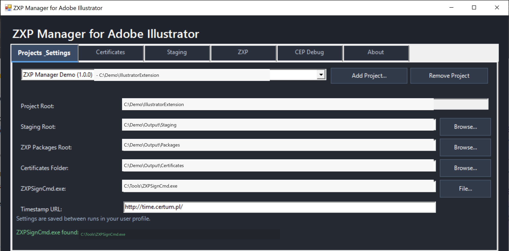
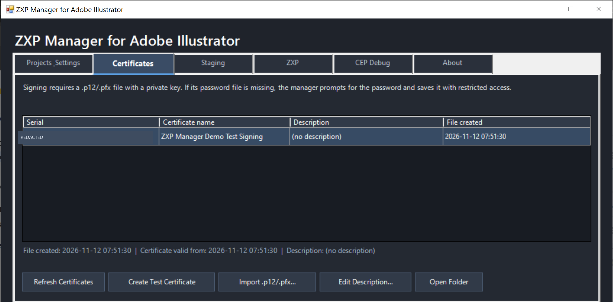
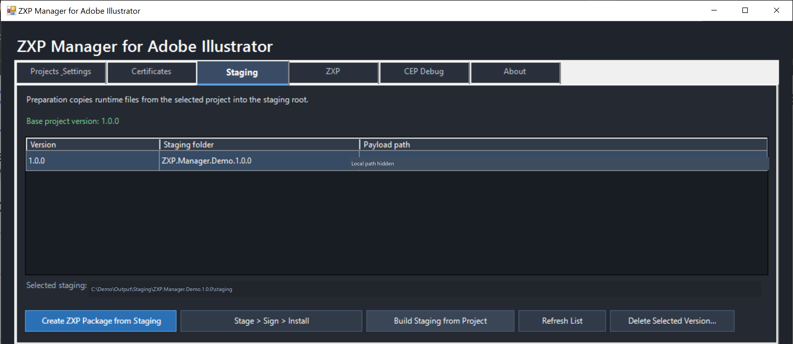
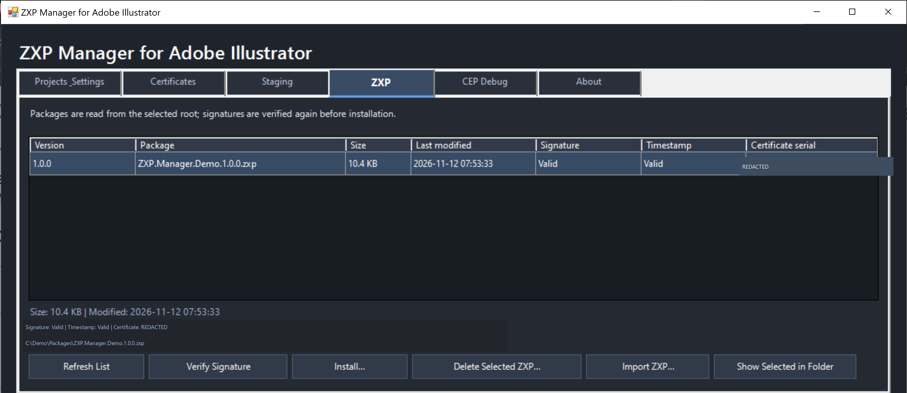
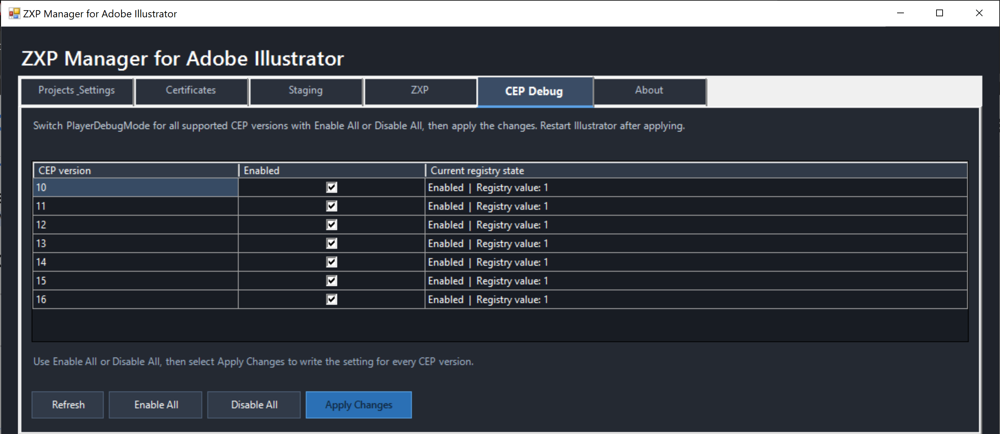

# ZXP Manager for Adobe CEP

[](https://github.com/generativearts/adobe-cep-zxp-manager/actions/workflows/powershell-validation.yml)
[](https://github.com/generativearts/adobe-cep-zxp-manager/actions/workflows/secret-scan.yml)

ZXP Manager for Adobe CEP is a Windows PowerShell tool for preparing, signing, verifying, and locally installing CEP extension packages (`.zxp`) for supported Adobe hosts. Package and staging names are derived from `ExtensionBundleName` in the selected CEP project's `CSXS\manifest.xml`; the name is converted to a filename-safe form and combined with the release version.

This is a standalone manager project. It does not contain an extension source project. On first launch, use **Projects & Settings** to add the folder containing the extension's `CSXS\manifest.xml`, then select that project. The manager stores its settings under `%APPDATA%\ZxpManager`.

The original ZXP Manager files are licensed under the [MIT License](./LICENSE). This license does not cover Adobe's ZXPSignCmd or other third-party components; see [Third-Party Notices](./THIRD-PARTY-NOTICES.md).

> These tools automate packaging and local testing. They do not submit a release to Adobe Exchange or guarantee that a package meets Adobe's current marketplace requirements. Check Adobe's latest submission, compatibility, and signing requirements before publishing.

## Requirements

- Windows with Windows PowerShell 5.1.
- An Adobe CEP project root, including `CSXS\manifest.xml`, `client`, and `host`. Installation supports the CEP host IDs `ILST` (Illustrator), `PHXS` (Photoshop), `PPRO` (Premiere Pro), `AEFT` (After Effects), and `IDSN` (InDesign). The package's target Adobe applications must support CEP; UXP extensions are not supported. Installation is blocked for missing or unrecognized host IDs.
- `ZXPSignCmd.exe`, obtained separately from Adobe's [CEP-Resources ZXPSignCMD directory](https://github.com/Adobe-CEP/CEP-Resources/tree/master/ZXPSignCMD). Place the Windows x64 executable at `zxp_tools\ZXPSignCmd.exe` or select its path in **Projects & Settings**. If it is missing, the settings tab offers a direct Adobe download link. The executable is intentionally not included in this repository; review Adobe's [CEP SDK license agreement](https://github.com/Adobe-CEP/CEP-Resources/blob/master/License/GenSDK_IHC-en_US-20120323_1224.pdf) and the [Third-Party Notices](./THIRD-PARTY-NOTICES.md).
- A signing certificate in PKCS#12 format (`.p12` or `.pfx`) with its private key.
- Creative Cloud Desktop and Adobe's Unified Plugin Installer Agent (UPIA) for installation. The install script can usually locate UPIA automatically.
- A supported Adobe host installation for end-to-end testing. Host and CEP runtime requirements are defined by the selected project's manifest.

## Quick start: GUI

From the repository root, run:

```powershell
.\zxp_manager_gui.bat
```

The launcher starts Windows PowerShell in STA mode with its console window hidden; the Windows Forms manager remains visible. If startup fails, an error dialog is shown. It provides these workflows:

- **Projects & Settings** — add, switch, and remove registered Adobe CEP projects, and configure project-specific staging, ZXP, and certificate folders alongside the shared timestamp and `ZXPSignCmd.exe` paths. Each project must contain `CSXS\manifest.xml`. Removing a project only unregisters it; it does not delete project files. Settings and recent selections are saved in `%APPDATA%\ZxpManager\settings.json`. Existing single-project settings, including settings from the former project-specific location, are migrated automatically when the generic settings file is first saved.
- **Certificates** — view certificates in a table with serial, name, description, and file-creation-time columns. Scan or open the certificate folder, create a self-signed test certificate, or import a `.p12`/`.pfx` certificate with a private key. If a certificate's password file is missing, it remains selectable; signing prompts for its password, validates it, and saves it in a file restricted to the current user, SYSTEM, and local administrators. The selected-certificate details also show its validity start time. File creation time is read from the Windows file system in local time; when a certificate is imported, it may reflect the time the file was copied into the manager's certificate folder rather than when the certificate was originally issued. Select a certificate and choose **Edit Description...** to add or change its description; clearing the field removes it. Descriptions are stored in the user's ZXP Manager settings and keyed by certificate thumbprint, so they persist across project switches and certificate file moves.
- **CEP Debug** — view `PlayerDebugMode` for CEP versions 10–16 in the current Windows user's `HKCU\Software\Adobe\CSXS.*` keys. Use **Enable All** or **Disable All**, then **Apply Changes** to set every supported version at once. The setting is shared by Adobe applications using the same CEP version; restart affected applications after changes. This tab does not change or depend on `install_extension.ps1`.
- **Staging** — view prepared versions in a table with version, staging-folder, and payload-path columns; build staging, create a ZXP from the selected staging, or run the full **Stage > Sign > Install** workflow. The ZXP creation button is highlighted as the primary action.
- **ZXP** — view packages in a table with version, filename, file size, last-modified time, signature, timestamp, and signing-certificate serial columns; import, select, verify, install, or remove packages, or show the selected ZXP highlighted in File Explorer. The selected-package summary also shows file size, last-modified time in local time, verification status, and path. Signature, timestamp, and certificate serial are shown after verification; a newly scanned package is marked as not verified. These statuses are held in memory and are not persisted across GUI restarts.
- **About** — a brief description, clickable links to the GitHub source and MIT License, and a reminder that the license applies to ZXP Manager code only; third-party components have their own terms.

The GUI requires confirmation for installation and checks that every mapped target Adobe application declared in the package manifest is closed. The installer verifies the package before invoking UPIA, then checks the installed manifest and version. Unknown host IDs are blocked rather than installed without a process check.

## Automated checks

GitHub Actions parses the PowerShell scripts, runs PSScriptAnalyzer with the focused rules in `.PSScriptAnalyzerSettings.psd1`, and runs Pester tests for certificate creation and Adobe host detection on pushes and pull requests targeting `main`. The Pester tests use temporary fixtures; they do not install packages into Adobe applications. A separate Gitleaks workflow checks the full Git history for secrets on pushes and pull requests. The badges report whether these checks pass; they are not security certifications. Run the tests locally with `Install-Module Pester -RequiredVersion 5.7.1 -Scope CurrentUser` followed by `Invoke-Pester -Path .\tests`. The GUI's `-ValidateOnly` checks can also be run locally with `powershell.exe -NoProfile -ExecutionPolicy Bypass -STA -File .\zxp_tools\zxp_manager_gui.ps1 -ValidateOnly`.

## Screenshots

| Projects & Settings | Certificates |
|---|---|
| [](screenshots/public/project-settings.png) | [](screenshots/public/certificates.png) |

| Staging | ZXP |
|---|---|
| [](screenshots/public/staging.png) | [](screenshots/public/zxp.png) |

| CEP Debug |
|---|
| [](screenshots/public/cep-debug.png) |

## Command-line workflows

Run these commands from the manager repository root. Because the CEP project is separate from this manager, pass its path with `-ProjectRoot` to each command.

### 1. Prepare staging

```powershell
.\zxp_tools\zxp_prepare_staging.ps1 `
  -ProjectRoot 'C:\path\to\cep-project'
```

The script prepares staging inside the selected CEP project by default:

```text
staging\<package-name>.<version>\staging\
```

`<package-name>` is derived from `ExtensionBundleName`; spaces and unsupported filename characters are converted to dots. If the bundle name is missing, `ExtensionBundleId` is used. The script checks that versions in `CSXS\manifest.xml`, `version.json`, and `package.json` agree; copies the CEP manifest, client and host runtime files, `font-registry.json`, and `version.json`; excludes client test/spec files; and checks that manifest entry points exist in the payload.

Optional parameters:

```powershell
.\zxp_tools\zxp_prepare_staging.ps1 `
  -ProjectRoot 'C:\path\to\project' `
  -StagingRoot 'C:\path\to\staging-root'
```

### 2. Create a test signing certificate

```powershell
.\zxp_tools\zxp_create_signing_certificate.ps1 `
  -ProjectRoot 'C:\path\to\cep-project'
```

The script creates a self-signed test certificate in `certificates\` by default and stores the certificate and generated password in separate files. It restricts their Windows ACLs to the current user, SYSTEM, and local administrators.

**A self-signed test certificate is for local testing, not production publication.** Confirm Adobe's current certificate requirements and use an appropriate production signing certificate for a marketplace release. Never commit certificate files, password files, or private keys.

### 3. Sign and verify a package

The signing script requires the selected certificate serial number:

```powershell
.\zxp_tools\zxp_sign.ps1 `
  -ProjectRoot 'C:\path\to\cep-project' `
  -CertificateSerial '<CERTIFICATE_SERIAL>'
```

Defaults are the project `certificates\` folder, current-version staging directory, `zxp_packages\<package-name>.<version>.zxp` output, `ZXPSignCmd.exe` beside the script, and the `http://time.certum.pl/` timestamp service. The script refuses to overwrite an existing package and runs signature/timestamp verification after signing.

To supply paths explicitly:

```powershell
.\zxp_tools\zxp_sign.ps1 `
  -CertificateSerial '<CERTIFICATE_SERIAL>' `
  -StagingDirectory 'C:\path\to\staging' `
  -OutputPath 'C:\path\to\<package-name>.<version>.zxp' `
  -CertificatesDirectory 'C:\path\to\certificates' `
  -SignToolPath 'C:\path\to\ZXPSignCmd.exe' `
  -TimestampUrl 'https://timestamp.example/'
```

Verify a package independently:

```powershell
.\zxp_tools\zxp_sign_verify.ps1 `
  -ProjectRoot 'C:\path\to\cep-project' `
  -ZxpPath '.\zxp_packages\<package-name>.<version>.zxp'
```

Verification succeeds only when `ZXPSignCmd` reports a successful signature and a valid timestamp. A valid cryptographic signature does not by itself establish publisher trust, marketplace approval, or application correctness.

### 4. Install through UPIA

Close the target Adobe application(s) listed in the ZXP manifest, then install a specific package:

```powershell
.\zxp_tools\zxp_install.ps1 `
  -ProjectRoot 'C:\path\to\cep-project' `
  -ZxpPath '.\zxp_packages\<package-name>.<version>.zxp'
```

The script verifies the signature and timestamp before installation. It invokes UPIA with `/install`, then checks that the installed CEP manifest has the package's bundle ID, extension ID, and version. UPIA is normally detected under the Adobe Desktop Common installation. To specify it manually, use `-UPIAPath`.

Preview the operation without installing:

```powershell
.\zxp_tools\zxp_install.ps1 `
  -ProjectRoot 'C:\path\to\cep-project' `
  -ZxpPath '.\zxp_packages\<package-name>.<version>.zxp' `
  -WhatIf
```

## Output and local data

- Staging payloads are written under `staging\`.
- ZXP packages are written under `zxp_packages\`.
- Signing certificates and password files are written under `certificates\`.
- GUI settings are stored in the current user's roaming application data, outside the project directory.
- The GUI stores a separate path and recent-selection profile for each registered project. The active project is restored on the next launch; shared signing-tool and timestamp settings apply to all projects.

The project `.gitignore` excludes staging, package, and certificate directories, certificate/password files, and the local `ZXPSignCmd.exe` binary. Keep those exclusions in place for private credentials and generated build artifacts.

## Troubleshooting

- **`ZXPSignCmd.exe was not found`** — set the executable path in the GUI's **Projects & Settings** tab or pass `-SignToolPath` to the relevant script.
- **Certificate not found** — confirm the serial number and that both `<SERIAL>.p12` and `<SERIAL>.password.txt` are in the configured certificate folder.
- **Version mismatch during staging** — update the release version consistently in the CEP manifest, `version.json`, and `package.json`.
- **Signature or timestamp verification failed** — check the certificate, package integrity, system clock, network access to the timestamp service, and the full `ZXPSignCmd` output.
- **UPIA not found** — install or update Creative Cloud Desktop, or pass `-UPIAPath` explicitly.
- **Installation or installed-version check failed** — close the target Adobe applications, verify the package's manifest IDs/version and supported Host IDs, and inspect the UPIA output and installed CEP manifest.

## Tool inventory

| File | Purpose |
|---|---|
| `zxp_manager_gui.ps1` | Windows Forms interface for the Adobe CEP publishing workflow |
| `zxp_common.ps1` | Shared project metadata and package naming helpers |
| `zxp_prepare_staging.ps1` | Build and validate the runtime staging payload |
| `zxp_create_signing_certificate.ps1` | Create a protected self-signed test certificate |
| `zxp_sign.ps1` | Sign a staging payload and verify the resulting package |
| `zxp_sign_verify.ps1` | Verify a ZXP signature and timestamp |
| `zxp_install.ps1` | Verify, install through UPIA, and check the installed version |
| `zxp_workflow_runner.ps1` | Execute a GUI workflow step and persist its exit code for the UI |
| `ZXPSignCmd.exe` | Adobe CEP signing and verification command-line tool; downloaded separately and not included in this repository |
